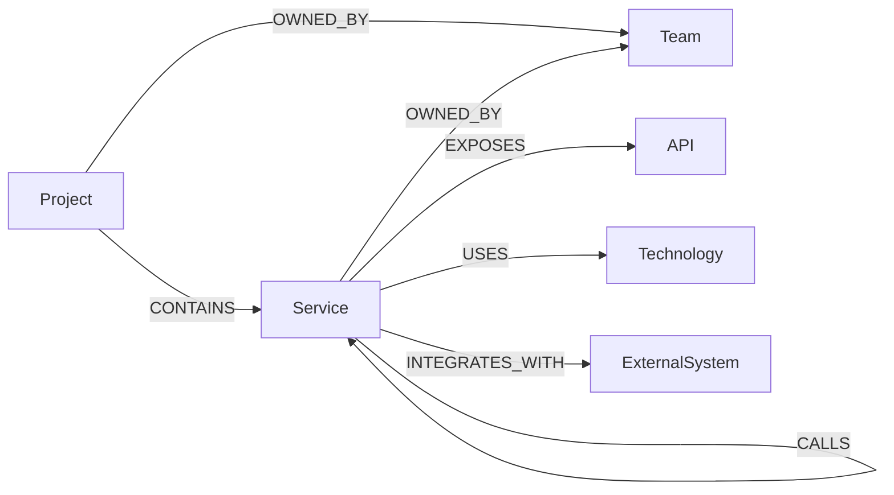
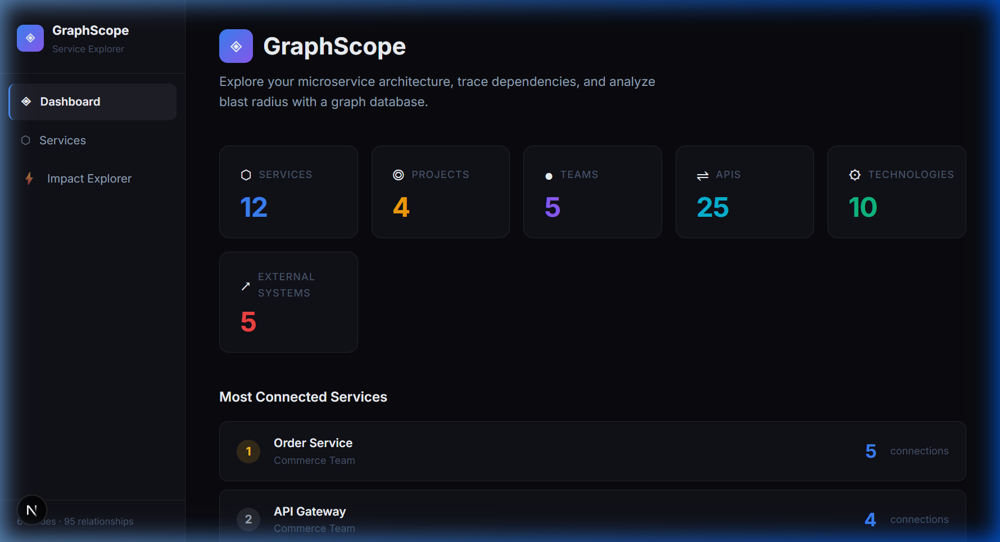
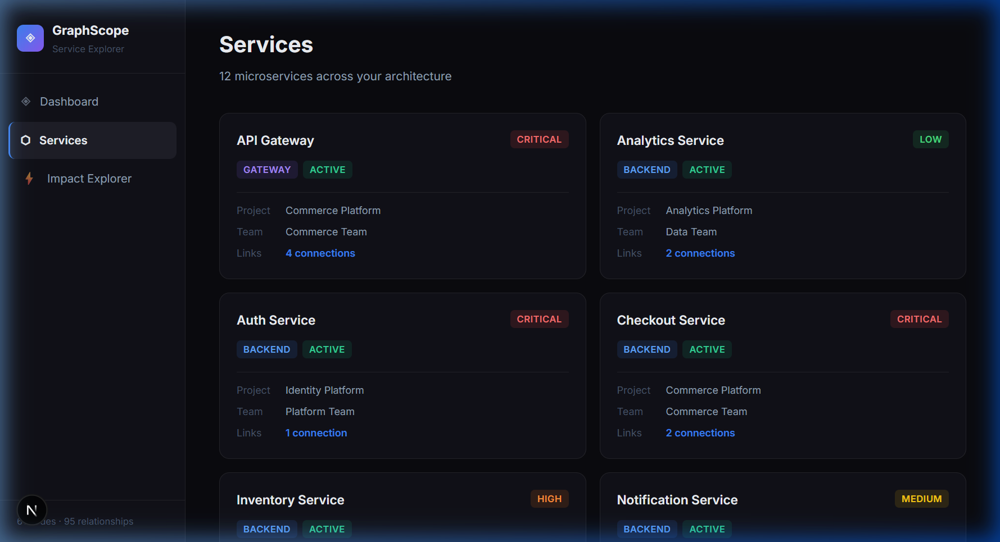
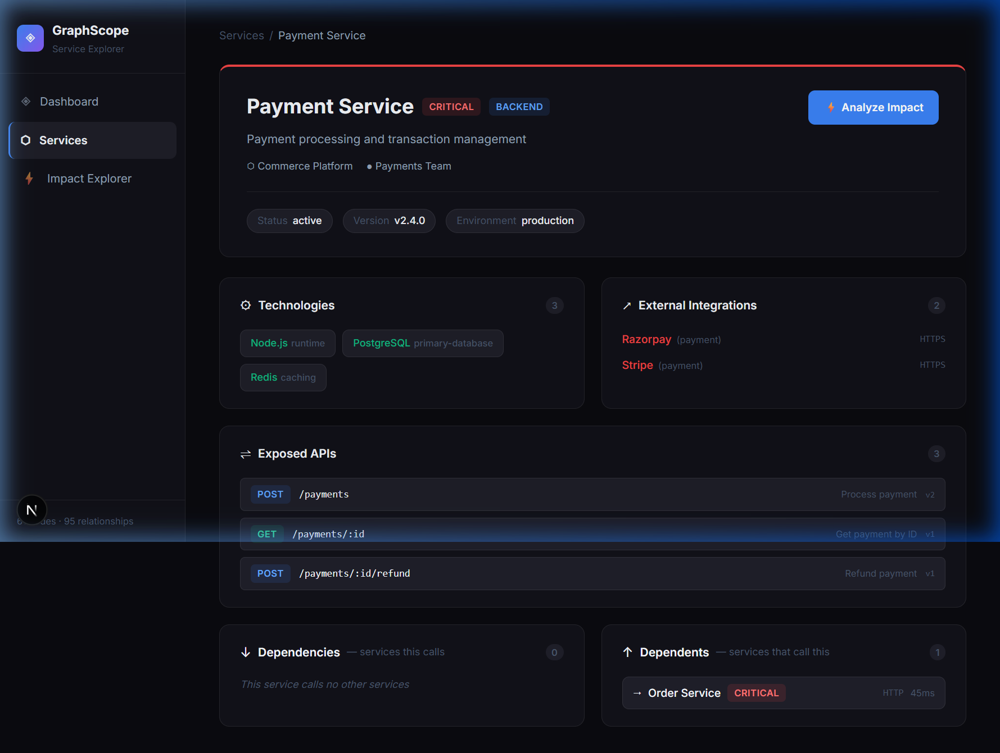
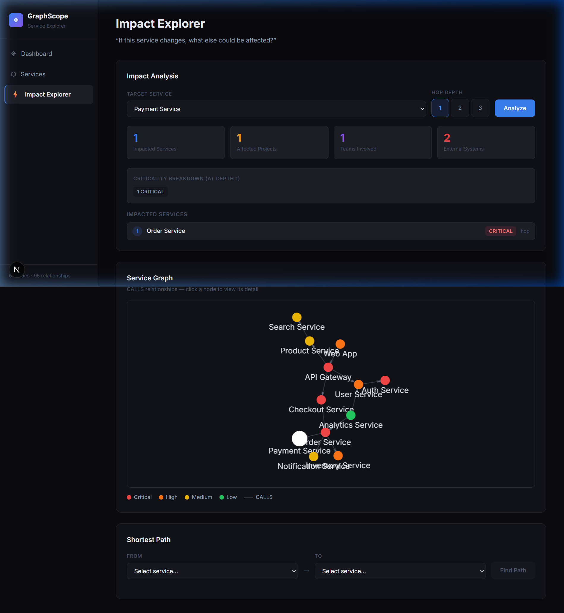

# GraphScope — Service Dependency Explorer

> "If this service changes, what else could be affected?"

A read-only graph database explorer for microservice architectures. Built for the CognoDB interview assignment.

**🚀 Live Demo:** [https://graph-database-application-eta.vercel.app](https://graph-database-application-eta.vercel.app)  
**📦 Repository:** [https://github.com/Mitesh1183/Graph-Database-Application](https://github.com/Mitesh1183/Graph-Database-Application)

---

## Overview

GraphScope lets engineers answer hard architectural questions instantly:

- Which services depend on **Payment Service**?
- If **Auth Service** goes down, what breaks at 3 hops?
- Is there a **dependency path** from Checkout to Auth?

The app connects to a **CognoDB (Neo4j)** graph database seeded with a realistic e-commerce microservice architecture — 61 nodes and 95 relationships.

---

## Why a Graph Database?

A relational database would require recursive CTEs or multiple self-joins to answer "find all services transitively impacted within 3 hops of a given service." The query would grow in complexity with each hop level.

With a graph database, the same question is one parameterized Cypher query:

```cypher
MATCH path = (dep:Service)-[:CALLS*1..3]->(:Service {id: $serviceId})
WITH dep, min(length(path)) AS hops
RETURN dep, hops ORDER BY hops, dep.name
```

**Expressiveness, not speed.** The graph model reflects the actual shape of the problem — services are vertices, CALLS relationships are edges. The schema is navigable, not normalized. You don't need to reconstruct relationships from foreign keys; they're first-class citizens.

Specifically, a graph DB excels here because:
1. **Variable-depth traversal** — 1-hop, 2-hop, or 3-hop impact analysis is the same query with a different range
2. **Shortest path** — built-in `shortestPath()` function traverses directed CALLS edges natively
3. **Rich relationship properties** — `protocol` and `latencyMs` live on the CALLS edge itself, not in a join table
4. **Natural mental model** — the data model diagram and the actual database schema are the same diagram

---

## Architecture

```
Browser (NO credentials)
    │ HTTPS
    ▼
Next.js Server (runtime = "nodejs")
    │  Route Handlers → Validation → Error Mapping
    │  Record → Domain Object Mapping
    │  Cypher Query Layer
    ▼
Neo4j Driver (globalThis singleton, session-per-request)
    │ Bolt
    ▼
CognoDB (61 nodes, 95 relationships)
```

**Why Route Handlers?** CognoDB credentials live only on the server. Route Handlers (`runtime = "nodejs"`) keep the Neo4j driver server-side — credentials never reach the browser bundle.

**Why no ORM?** Cypher is not SQL. An ORM would abstract away the graph traversal patterns that are the entire point of using a graph DB. Direct Cypher + parameterized queries gives full control with zero leaking abstractions.

---

## Graph Data Model

### Node Types

| Label | Key Properties |
|---|---|
| `Project` | id, name, description, status |
| `Service` | id, name, type, status, version, environment, criticality |
| `API` | id, path, method, description |
| `Technology` | id, name, category |
| `Team` | id, name, lead, department |
| `ExternalSystem` | id, name, type |

### Relationship Types

```
Project   ──CONTAINS──▶         Service
Project   ──OWNED_BY──▶         Team
Service   ──CALLS──▶            Service          { protocol, latencyMs }
Service   ──EXPOSES──▶          API              { version }
Service   ──USES──▶             Technology       { purpose }
Service   ──OWNED_BY──▶         Team
Service   ──INTEGRATES_WITH──▶  ExternalSystem   { protocol }
```



### Counts

| Type | Count |
|---|---|
| Nodes total | **61** |
| Relationships total | **95** |
| CONTAINS | 12 |
| OWNED_BY | 16 |
| CALLS | 12 |
| EXPOSES | 25 |
| USES | 25 |
| INTEGRATES_WITH | 5 |

---

## Key Cypher Queries

### Impact Analysis (depth-aware)

```cypher
MATCH path = (dep:Service)-[:CALLS*1..3]->(:Service {id: $serviceId})
WITH dep, min(length(path)) AS hops
OPTIONAL MATCH (dep)<-[:CONTAINS]-(p:Project)
OPTIONAL MATCH (dep)-[:OWNED_BY]->(t:Team)
RETURN dep, hops, p AS project, t AS team
ORDER BY hops, dep.name
```

The `WITH` aggregation happens first → OPTIONAL MATCHes are 1:1 → no Cartesian product. The `min(length(path))` ensures each service appears once with its minimum hop count (deduplication built-in).

### Shortest Path (directed)

```cypher
MATCH path = shortestPath(
  (a:Service {id: $fromId})-[:CALLS*]->(b:Service {id: $toId})
)
RETURN [n IN nodes(path) | n] AS pathNodes, length(path) AS hops
```

Directed (`->`) reflects actual dependency direction: "A calls B" means A depends on B.

---

## Seed Data

The database contains a realistic e-commerce architecture:

- **4 Projects**: Commerce, Identity, Engagement, Analytics Platforms
- **5 Teams**: Commerce, Platform, Engagement, Data, Payments
- **12 Services**: Web App → API Gateway → Checkout → Order → Payment (and more)
- **10 Technologies**: Node.js, TypeScript, React, PostgreSQL, Redis, MongoDB, Elasticsearch, Docker, AWS, Next.js
- **5 External Systems**: Razorpay, Stripe, Warehouse API, SendGrid, Salesforce
- **25 APIs**: Exposed by backend and gateway services

---

## Setup

### Prerequisites

- Node.js 18+
- A CognoDB Cloud account and free instance (see below)

### 0. Create a CognoDB Cloud instance

1. **Sign up** — Go to [https://console.cognodb.com/signup](https://console.cognodb.com/signup). The free tier requires no credit card.
2. **Create a free instance** — From the console, create a free (c0) instance and pick a region. It provisions in under a minute.
3. **Save your connection details** — You will receive:
   - A connection URI of the form `bolt+s://<instance-id>.databases.cognodb.cloud`
   - A generated password for the user `cognodb` (shown exactly once — copy it immediately)
4. **Keep your instance running** — The evaluator may test the app against live data after submission.

### 1. Clone & install

```bash
git clone <repo-url>
cd graphscope
npm install
```

### 2. Configure environment

```bash
cp .env.example .env.local
```

Edit `.env.local`:

```env
COGNODB_URI=bolt+s://your-instance.databases.cognodb.cloud
COGNODB_USER=cognodb
COGNODB_PASSWORD=your-generated-password
COGNODB_DATABASE=neo4j
NEXT_PUBLIC_BASE_URL=http://localhost:3000
```

### 3. Seed the database

```bash
npm run db:seed
```

This runs an idempotent MERGE-based script. Safe to run multiple times. Verifies 61 nodes and 95 relationships at the end.

To reset and re-seed:

```bash
npm run db:reset
npm run db:seed
```

### 4. Run locally

```bash
npm run dev
```

Open [http://localhost:3000](http://localhost:3000).

---

## Scripts

| Command | Description |
|---|---|
| `npm run dev` | Start development server |
| `npm run build` | Build for production |
| `npm run test` | Run unit tests (vitest) |
| `npm run db:seed` | Seed the database (idempotent) |
| `npm run db:reset` | Delete all data (dev only) |
| `npm run lint` | Run ESLint |

---

## Live Demo

| | |
|---|---|
| **Hosted App** | [https://graph-database-application-eta.vercel.app](https://graph-database-application-eta.vercel.app) |
| **GitHub Repo** | [https://github.com/Mitesh1183/Graph-Database-Application](https://github.com/Mitesh1183/Graph-Database-Application) |
| **Screen Recording** | [https://www.loom.com/share/48da099dd7b042fc9e90c9859434e113](https://www.loom.com/share/48da099dd7b042fc9e90c9859434e113) |

---

## Deployment

Deploy to **Vercel**:

1. Push to GitHub
2. Import project in Vercel dashboard
3. Add all five environment variables from `.env.local`:
   - `COGNODB_URI`
   - `COGNODB_USER`
   - `COGNODB_PASSWORD`
   - `COGNODB_DATABASE`
   - `NEXT_PUBLIC_BASE_URL` — set this to your deployed Vercel URL, e.g. `https://your-app.vercel.app`
4. Deploy — Route Handlers run as serverless Node.js functions

**Important**: `COGNODB_URI` credentials never reach the browser bundle (only read server-side via `runtime = "nodejs"`).

---

## Design Decisions

| Decision | Rationale |
|---|---|
| Read-only | Assignment asks to demonstrate graph querying, not CRUD. Eliminating writes keeps the scope tight and the queries pure. |
| No AI | The queries themselves are the feature. AI summarization would obscure the graph traversal that's being demonstrated. |
| No ORM | Cypher is expressive enough directly. An ORM would hide the traversal patterns. |
| Environment as property | `Service.environment` is a property, not a separate node — environments are attributes of services, not graph entities. |
| Service Detail before Dashboard | Service Detail is the most data-rich page and exercises the most Cypher queries; build the hard page first. |
| 6 focused queries for Service Detail | Avoids Cartesian products that arise from single-query joins across many relationship types. |

---

## Screenshots

### Dashboard


### Services List


### Service Detail


### Impact Explorer

